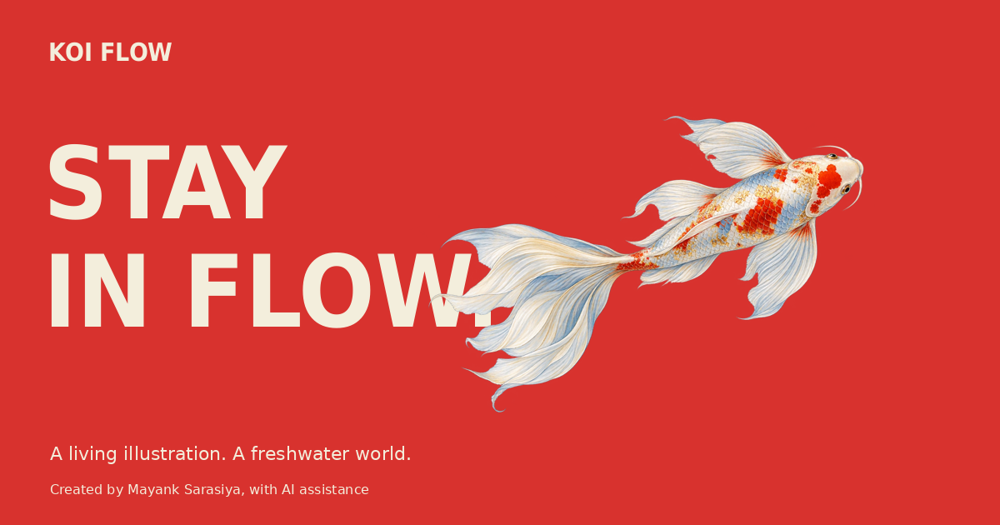

# Koi Flow — a living illustration

A scroll-driven, image-based Canvas 2.5D koi journey by Mayank Sarasiya, with AI assistance. Original koi artwork generated with OpenAI.



[Live demo](https://3d-fish-website.vercel.app/) · [Source](https://github.com/Kkknight-12/3d-fish-website)

The live demo opened successfully on 12 October 2026. The image is the existing static sharing preview.

## What to try

Scroll through three chapters and back again to see the koi change pose alongside kinetic typography and educational field notes. The independent water layer uses a persistent heightfield, pixel refraction and a fading wake.

- Choose Gentle, Drift or Lively in the motion controls.
- Pause swimming and breathing. Deliberate scrolling still changes the fish's pose.
- Open **Behind the flow** for preferences, credits and sources.
- Reduced motion holds the still pose, removes depth travel and suppresses the extra editorial effects. Play is an explicit opt-in under reduced motion; the dialog preference lasts for the browser tab session.

## Run locally

Use Node.js 20 or newer and npm. There are no runtime dependencies to install.

```bash
git clone https://github.com/Kkknight-12/3d-fish-website.git
cd 3d-fish-website
npm run check
npm test
npm run build
npm run dev -- --port 5185
```

Open [the built experience](http://127.0.0.1:5185/dist/index.html). The server binds to localhost. The source experience is at `/`; [the native-scroll QA dashboard](http://127.0.0.1:5185/qa-suite.html) and [frozen-time geometry inspection](http://127.0.0.1:5185/qa.html) are source-only QA pages.

To serve only the production output after building:

```bash
npm run preview -- --port 5185
```

Then open [the production preview](http://127.0.0.1:5185/). Static output is `dist/`.

## How it works

- [index.html](index.html) and [style.css](style.css): native chapters, annotations, integrated credits and responsive composition.
- [app.js](app.js), [motion.js](motion.js), [spine.js](spine.js), [scroll.js](scroll.js) and [view-beat.js](view-beat.js): swimming, breathing and scroll-driven posing.
- [pose-3d.js](pose-3d.js), [body-geometry.js](body-geometry.js) and [fin-geometry.js](fin-geometry.js): projected geometry for painted depth turns.
- [view-renderer.js](view-renderer.js), [eye-atlas.js](eye-atlas.js), [volume-raster.js](volume-raster.js) and [mouth-barbels.js](mouth-barbels.js): painted skin, eyes, fins and whiskers.
- [story.js](story.js), [heightfield-water.js](heightfield-water.js) and [water-motion.js](water-motion.js): reversible text choreography and independent water.
- [reference-fit.js](reference-fit.js): framing the illustration within the page.

No backend, installed runtime libraries, external fonts or analytics are required. Original artwork and generation prompts are retained.

## Verification and limits

On 12 October 2026, published source `23a0278` passed `npm run check`, all **92 tests** in `npm test`, and `npm run build` on macOS with Node 22.12.0 and npm 10.9.0. The built page, preview image and both QA URLs returned HTTP 200 locally. Verification used port 5190 to avoid other projects; the documented port is configurable.

This is a painted 2.5D illustration with simplified anatomy and depth sorting. The water is a stylized CPU optical simulation. Physical mobile performance and a universal frame-rate guarantee are not established. See [KNOWN-ISSUES.md](KNOWN-ISSUES.md) for detailed limitations and historical verification scope.

## Credits and references

Created by **Mayank Sarasiya**. Original fish artwork and matching views were generated with OpenAI image generation. Development, research and testing were assisted by **OpenAI Codex** and **dots**.

- Original visual inspiration: [marina_uiux](https://www.instagram.com/marina_uiux/). [Original reel](https://www.instagram.com/p/DcwZJw2o-jr/).
- Water algorithm adaptations: [jquery.ripples by Pim Schreurs](https://github.com/sirxemic/jquery.ripples) and [WebGL Water by Evan Wallace](https://github.com/evanw/webgl-water), MIT licensed. Custom CPU implementation; neither full library is installed.
- Watched water-motion references: [Pexels: Koi fishes](https://www.pexels.com/video/koi-fishes-856951/) and [Pexels: pond full of koi](https://www.pexels.com/video/slow-motion-video-of-a-pond-full-of-koi-fish-4162439/).
- [Full reference and provenance inventory](REFERENCES.md), including primary fish-fact sources, layout research and the playback limitation on the user-provided YouTube reference.
- [Third-party copyright and MIT license notices](THIRD-PARTY-WATER-LICENSES.txt), retained in the production build.

The on-site “Behind the flow” dialog contains a compact “Credits & sources” expander. References are not bundled footage, installed dependencies or endorsements.

## Development history

[HEIGHTFIELD-REVIEW.md](HEIGHTFIELD-REVIEW.md) records the water implementation; [REWORK-REVIEW.md](REWORK-REVIEW.md) records the earlier immersive release. [WATER-PREVIEW-REVIEW.md](WATER-PREVIEW-REVIEW.md) records superseded experiments. [BASELINE-VERIFICATION.json](BASELINE-VERIFICATION.json) describes an earlier geometry baseline. Their historic pass counts belong to their recorded revisions.
